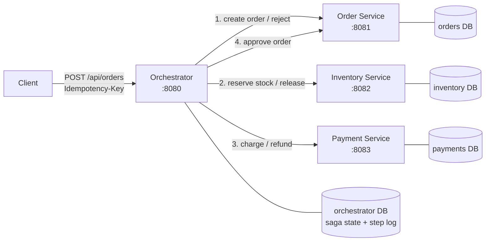
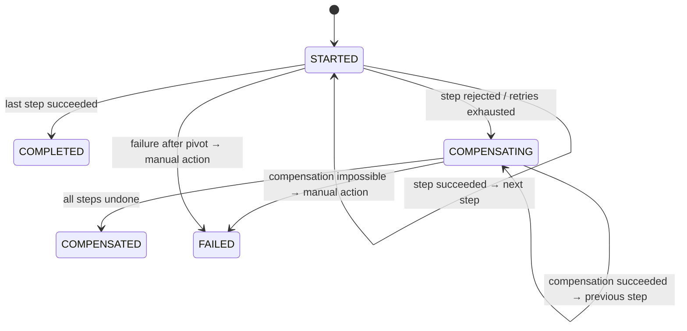

# Order Fulfilment Saga Orchestrator


Places an order across three independent microservices (**orders**, **inventory**, **payments**)
using the **orchestrated Saga pattern**. There is no distributed transaction. If any step fails,
the orchestrator runs **compensating actions** in reverse order, so the system ends up consistent:
either the whole order happened or none of it did.

**Tech:** Java 17 · Spring Boot · Spring Data JPA · PostgreSQL · Flyway · Docker Compose · GitHub Actions

---

## Architecture



Each service owns its own database (**database per service**). Services share no code; they only
share HTTP contracts.

### Saga steps

| # | Step | Participant call | Compensation |
|---|---|---|---|
| 1 | `CREATE_ORDER` | `POST /api/orders` → order `PENDING` | `POST /api/orders/{id}/reject` |
| 2 | `RESERVE_INVENTORY` | `POST /api/inventory/reservations` | `POST /api/inventory/reservations/{id}/release` |
| 3 | `PROCESS_PAYMENT` ⚑ pivot | `POST /api/payments` | `POST /api/payments/{id}/refund` |
| 4 | `APPROVE_ORDER` | `POST /api/orders/{id}/approve` | *none: forward recovery only* |

Once payment is captured (the **pivot**), the saga never goes backwards. `APPROVE_ORDER` is retried
until it succeeds, rather than refunding a customer because of a temporary glitch.

### Saga state machine



---

## Reliability design

### 1. Durable state transitions
Saga state lives in PostgreSQL (`saga_instances`). **Every transition is committed before the
next participant call.** If the orchestrator crashes at any point, the saga resumes from its last
committed step. Every attempt is written to an append-only `saga_step_log`, which serves as the
audit trail and is returned by `GET /api/orders/{id}`.

### 2. Three kinds of outcome

| Participant response | Classified as | Orchestrator reaction |
|---|---|---|
| `2xx` | **Success** | Move to the next step |
| `4xx` (e.g. `422` declined, `409` conflict) | **Rejected** | Business "no". The participant changed nothing, so **compensate the earlier steps only** |
| `5xx`, `408`, `429`, timeout, connection refused | **Transient** | Retry. If retries run out, **compensate this step too**, because we can't know whether the timed-out call was applied |

### 3. Two layers of retry
- **In-process**: up to 3 attempts per call, with exponential backoff and jitter. This absorbs short glitches.
- **Durable**: if in-process retries fail, the next attempt is **stored in the database**
  (`next_attempt_at`, with exponential backoff up to 5 attempts). The worker thread is released, and a
  recovery job resumes the saga when it's due. This survives longer outages and restarts.

### 4. Timeouts
Every participant call has a 1 s connect timeout and a 2 s read timeout, so a hung service can never
block a saga worker indefinitely.

### 5. Idempotency everywhere
- **Client → orchestrator:** `Idempotency-Key` header. A retry with the same key returns the original
  saga (`200` + `Idempotent-Replayed: true`) without starting a new one. Reusing a key with a different
  body returns `422`. A unique constraint guards against concurrent duplicates.
- **Orchestrator → participants:** the **saga id is the idempotency key** for every call. Repeating
  `reserve`, `charge`, `refund` and so on returns the original result and has no side effects.
  A stored payment decline returns the same decline on retry; it is never charged on the second try.

### 6. Compensation can arrive before the action
A request can time out at the orchestrator but still be delivered to the participant **after**
compensation has already run. Each participant handles this:
a `release`/`refund`/`reject` for an unknown saga writes a **tombstone**
(`RELEASED`/`VOIDED`/`REJECTED`), and the late original request is then refused with `409`. Stock and
money can't leak this way.

### 7. Leases, so multiple instances can run safely
The orchestrator can run as several instances. A worker **claims a lease** on a saga (row lock +
`locked_until` + a random **fencing token**). If a worker stalls past its lease and another instance
takes over, the stale worker's result is **discarded**, because its token no longer matches.
Sagas whose worker died are picked up by the recovery job when the lease expires.

### 8. Concurrency inside participants
The inventory service locks product rows with `SELECT … FOR UPDATE` in SKU order (no deadlocks).
A test runs 12 concurrent sagas against 3 units of stock and checks that exactly 3 succeed, so
stock is never oversold.

---

## Running it

```bash
docker compose up --build
```

This starts PostgreSQL (four databases) and the four services. The inventory is seeded with demo
products: `LAPTOP-15`, `MOUSE-WL`, `KEYBOARD-MK`, `MONITOR-27` and `HEADSET-NC` (only 3 in stock).

### Try the scenarios

```bash
# ✅ Happy path
curl -s -X POST localhost:8080/api/orders -H 'Content-Type: application/json' \
  -H 'Idempotency-Key: order-001' \
  -d '{"customerId":"cust-1","items":[{"sku":"LAPTOP-15","quantity":1,"unitPrice":1200.00}]}'

# Poll the saga (status, current step, full history)
curl -s localhost:8080/api/orders/<sagaId>

# ❌ Payment declined (limit is 5000): inventory is released and the order rejected
curl -s -X POST localhost:8080/api/orders -H 'Content-Type: application/json' \
  -H 'Idempotency-Key: order-002' \
  -d '{"customerId":"cust-2","items":[{"sku":"MONITOR-27","quantity":2,"unitPrice":3000.00}]}'

# ❌ Out of stock: the order is rejected
curl -s -X POST localhost:8080/api/orders -H 'Content-Type: application/json' \
  -H 'Idempotency-Key: order-003' \
  -d '{"customerId":"cust-3","items":[{"sku":"HEADSET-NC","quantity":5,"unitPrice":100.00}]}'
```

**Simulate an outage:** run `docker compose stop payment-service`, place an order, and watch
`RETRY_SCHEDULED` entries appear in its history. Then run `docker compose start payment-service`, and the
saga completes on its own. Or start everything with `PAYMENT_FAILURE_RATE=0.3` to make 30% of
payment calls fail at random.

Example of a saga that rode out a payment-service outage:

```json
{
  "status": "COMPLETED",
  "history": [
    { "step": "CREATE_ORDER",      "phase": "EXECUTE", "result": "SUCCEEDED" },
    { "step": "RESERVE_INVENTORY", "phase": "EXECUTE", "result": "SUCCEEDED" },
    { "step": "PROCESS_PAYMENT",   "phase": "EXECUTE", "result": "RETRY_SCHEDULED",
      "detail": "attempt 1 failed, retry at ...: I/O error: Connection refused" },
    { "step": "PROCESS_PAYMENT",   "phase": "EXECUTE", "result": "RETRY_SCHEDULED" },
    { "step": "PROCESS_PAYMENT",   "phase": "EXECUTE", "result": "SUCCEEDED" },
    { "step": "APPROVE_ORDER",     "phase": "EXECUTE", "result": "SUCCEEDED" }
  ]
}
```

---

## API

### Orchestrator (`:8080`)
| Method | Path | Description |
|---|---|---|
| `POST` | `/api/orders` | Start an order saga. Requires `Idempotency-Key`. Returns `202 Accepted` + `Location` |
| `GET` | `/api/orders/{sagaId}` | Saga status, current step, failure reason and step history |

### Participants
| Service | Endpoints |
|---|---|
| Order `:8081` | `POST /api/orders` · `POST /api/orders/{sagaId}/approve` · `POST /api/orders/{sagaId}/reject` · `GET /api/orders/{sagaId}` |
| Inventory `:8082` | `POST /api/inventory/reservations` · `POST /api/inventory/reservations/{sagaId}/release` · `GET /api/inventory/products/{sku}` |
| Payment `:8083` | `POST /api/payments` · `POST /api/payments/{sagaId}/refund` · `GET /api/payments/{sagaId}` |

Errors use [RFC 9457 Problem Details](https://www.rfc-editor.org/rfc/rfc9457).

---

## Tests

```bash
./mvnw verify
```

Tests use H2 in PostgreSQL mode, so no Docker is needed.

| Module | What is covered |
|---|---|
| orchestrator | Happy path; payment declined → reverse compensation without a refund; out of stock; short glitch absorbed by in-process retry; outage → durable retry → recovery; persistent timeout → compensation **including** the timed-out step; failure after the pivot → forward recovery, never a refund; failed compensation → `FAILED`; idempotent start and key reuse; **crash recovery** from the last committed step; **lease fencing** (a stale worker can't overwrite progress); HTTP → outcome classification (`2xx`/`4xx`/`5xx`/`429`/timeout/connection refused) |
| order | Idempotent create/approve/reject, tombstone blocks late create, approved order can't be rejected |
| inventory | Idempotent reserve/release, all-or-nothing reservation, tombstone, **no overselling under 12 concurrent sagas** |
| payment | Idempotent charge/refund, stored decline, refund of a declined payment is a no-op, tombstone blocks late charge |

## Project structure

```
├── orchestrator-service/   # Saga engine: state machine, runner, retries, leases, recovery job
├── order-service/          # Orders: PENDING → APPROVED | REJECTED
├── inventory-service/      # Stock with row-level locking
├── payment-service/        # Charges, refunds, configurable decline limit
├── docker/                 # Postgres init (one database per service)
├── docker-compose.yml
└── Dockerfile              # Single multi-stage build, parameterised by SERVICE
```
